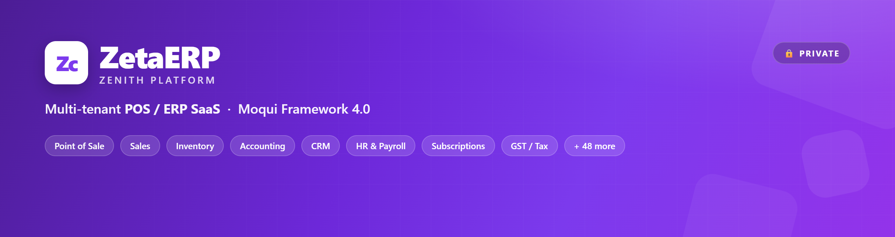

<p align="center">
  
</p>

<h1 align="center">ZetaERP&nbsp;·&nbsp;Zenith</h1>

<p align="center">
  A full, multi-tenant <strong>POS / ERP SaaS</strong> — Point of Sale, Sales, Purchase, Inventory,
  Accounting, CRM, HR, Manufacturing, Pricing, Subscriptions, GST/Tax and more —<br>
  built on the <strong>Moqui Framework 4.0</strong> and live at
  <a href="https://erp.zetaclantech.com">erp.zetaclantech.com</a>.
</p>

<p align="center">
  <a href="../../actions/workflows/repo-guards.yml"></a>
  
  
  
  
  
  
  
</p>

<p align="center">
  <a href="#-read-this-first">Read first</a> ·
  <a href="#-tech-stack">Stack</a> ·
  <a href="#-two-ui-surfaces">Surfaces</a> ·
  <a href="#-repository-layout">Layout</a> ·
  <a href="#-getting-started">Getting started</a> ·
  <a href="#-contributing">Contributing</a> ·
  <a href="#-documentation">Docs</a>
</p>

---

> **🔒 Private & proprietary.** This repository backs a **live commercial system with real
> customer data**. Do not share, fork, or publish any part of it outside the team. See
> [`LICENSE`](LICENSE).

## ⚠️ Read this first

A careless change here can leak customer data, corrupt billing, or take the site down. These
rules are **non-negotiable** (full detail in [`CONTRIBUTING.md`](CONTRIBUTING.md) and
[`SECURITY.md`](SECURITY.md)):

| # | Rule |
|:-:|------|
| 1 | **Never commit secrets** — no passwords, API keys, tokens, private keys, or real `.env`. |
| 2 | **Never expose** customer / user / security data in code, commits, issues, or PRs. |
| 3 | **Never fabricate** business/legal data (GSTIN, HSN, PAN, prices, stock) — ask the owner. |
| 4 | **Billing paths must be safe for live tenants** — verify on a throwaway tenant, never a real one. |
| 5 | **Clean up all test data** after verifying. |
| 6 | **Never alter or renumber** an already-issued bill / invoice. |

## 🧱 Tech stack

<table>
<tr><td><strong>Framework</strong></td><td>Moqui Framework 4.0 (Java / Groovy)</td></tr>
<tr><td><strong>Application</strong></td><td>XML screens, entities &amp; services; Groovy lives inside <code>&lt;script&gt;</code> CDATA — <em>0</em> loose <code>.java</code>/<code>.groovy</code> files</td></tr>
<tr><td><strong>Templating</strong></td><td>FreeMarker</td></tr>
<tr><td><strong>Database</strong></td><td>PostgreSQL</td></tr>
<tr><td><strong>Search</strong></td><td>OpenSearch</td></tr>
<tr><td><strong>UI</strong></td><td><strong>/apps</strong> (Bootstrap 3) &amp; <strong>/qapps</strong> (Quasar/Vue SPA) — same XML, two renderers</td></tr>
<tr><td><strong>Deploy</strong></td><td>Docker (app + Postgres) behind nginx + Cloudflare</td></tr>
</table>

## 🖥️ Two UI surfaces

The same Moqui screens render on both **/apps** (server-rendered Bootstrap) and **/qapps**
(Quasar SPA). They do **not** share utility classes, and **/qapps strips `<script>` and
`<style>` tags** (bootstrap JS there via an `` attribute). The shared theme lives in
`component/zenith-erp-app/screen/zenithstatic/css/zenith-theme-v4.css`.

## 📂 Repository layout

```
component/            56 Moqui components (zenith-erp-*), ~770 XML files
  zenith-erp-app/       shell, theme CSS/JS, ZenithApp.xml
  zenith-erp-base/      shared services, org-scoped party picker
  zenith-erp-pos/       point of sale
  zenith-erp-saas/      platform billing, tenants, plans, invoices
  zenith-erp-<module>/  sales, purchase, inventory, accounting, crm, hr, …
docs/
  SOP-commit-and-deploy.md   the commit → PR → production runbook
  SOP-production-bug-PR.pdf  how to raise a production-bug PR (reproduce → merge)
  infra/                     deploy scripts, lint guards, git hooks, sync/audit tooling
  qa/  security/  superpowers/
.github/workflows/    CI guards (lint, no-direct-push, no-force-push)
```

<details>
<summary><strong>All 56 modules</strong></summary>

`accounting` · `analytics` · `app` · `approvals` · `assets` · `attendance` · `barcode` · `base` ·
`contacts` · `crm` · `discuss` · `distribution` · `documents` · `ecommerce` · `events` ·
`expenses` · `fieldservice` · `fleet` · `franchise` · `giftcard` · `helpdesk` · `hr` · `india` ·
`integrations` · `inventory` · `loyalty` · `maintenance` · `manufacturing` · `marketing` ·
`omnichannel` · `payroll` · `plm` · `pos` · `pricing` · `project` · `promotions` · `purchase` ·
`quality` · `recruitment` · `rental` · `returns` · `saas` · `sales` · `settings` · `sign` ·
`stores` · `studio` · `subscriptions` · `tax` · `timeoff` · `timesheets` · `uae` · `uk` · `us` ·
`website` · `workshop`
</details>

## 🚀 Getting started

```bash
git clone https://github.com/amalnathkp13-boop/zenith-erp.git
cd zenith-erp

# Arm the pre-commit lint guards (once per clone)
sh docs/infra/install-git-hooks.sh
```

This repo is the **source of truth for source**; the running system is the Docker container on
the server. Deploying needs SSH access from the owner — **infra credentials are not in this
repo**. New here? Start with the runbook: **[`docs/SOP-commit-and-deploy.md`](docs/SOP-commit-and-deploy.md)**.

## 🤝 Contributing

`master` is **PR-only** — CI flags direct pushes and force-pushes.

```bash
git switch -c feature/<name>          # branch off master
# …edit; stage explicit paths (never git add -A) …
git commit -m "type: subject"
git push -u origin feature/<name>
gh pr create                          # merge after review + green checks
```

| Guard (GitHub Actions) | Fires on |
|---|---|
| **guards** | every push / PR — CSS, party-picker, cross-module transitions, DOM collisions |
| **no-direct-push** | a commit reaches `master` without a PR |
| **no-force-push** | any force-push to `master` |

Full workflow, gotchas and the safety checklist: [`CONTRIBUTING.md`](CONTRIBUTING.md).

## 📚 Documentation

| Doc | What |
|---|---|
| [`CONTRIBUTING.md`](CONTRIBUTING.md) | Workflow, lint guards, the non-negotiables |
| [`SECURITY.md`](SECURITY.md) | Reporting, secrets policy, multi-tenant isolation |
| [`docs/SOP-commit-and-deploy.md`](docs/SOP-commit-and-deploy.md) | Commit → PR → production runbook + rollback |
| [`docs/SOP-production-bug-PR.pdf`](docs/SOP-production-bug-PR.pdf) | How to raise a production-bug PR that merges on the first pass |
| [`docs/infra/`](docs/infra) | Deploy scripts, git hooks, live-sync audit, branch-protection prep |

<p align="center"><sub>© 2024–2026 ZetaERP · Proprietary — All Rights Reserved · <strong>Confidential</strong></sub></p>
