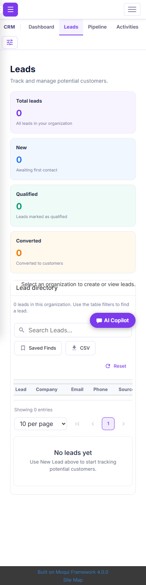
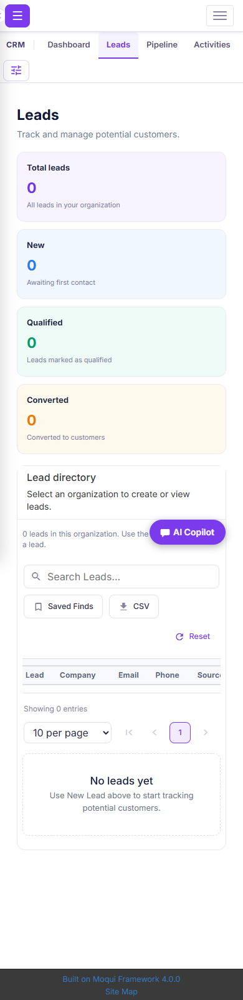
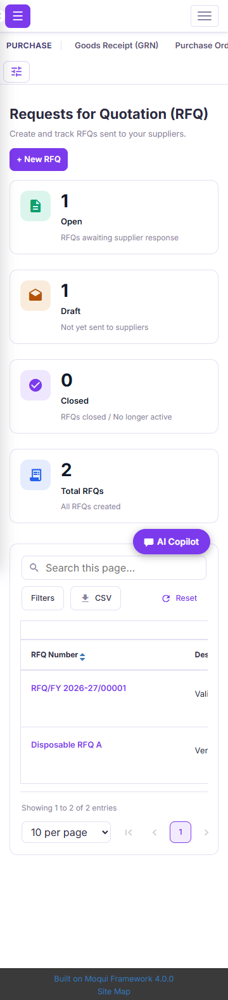

# Zenith ERP module audit — 20 October 2026

This is first-phase evidence for commit `e41c1eef8de736796f0f437fcbd1d50b65f0acab`. The subsequent [POS Drive follow-up](../pos-drive-reports/README.md) records new POS changes, fresh regression results and reports still awaiting a policy/configuration decision. Its evidence supersedes the historical POS same-source reuse below for the final PR candidate.

This audit covers Shops, Sales, Inventory, POS, Tax, Purchase, Dashboard, CRM, Contacts, Pricing, Barcode, My Subscription, customer Subscriptions, and platform subscription administration. The reviewed base is `ac5c8f5cbf74b20183dde642596bc1628919bea7`, which already includes merged PR #137. That PR's POS catalogue, shop mode removal and Purchase status fixes are not counted again as new findings.

All writes used synthetic records in disposable, loopback-only, in-memory H2 databases. Production, customer databases, issued customer documents, payment providers and physical printers were not changed. Test helpers are documentation assets and must never be installed in production.

## Confirmed findings and fixes

| ID | Reproduction | Result after the fix |
| --- | --- | --- |
| AUDIT-01 | A CRM manager changes the editable active-organization preference to an organization they do not belong to, then writes a lead. | CRM screens and services resolve the selection through actual memberships. Foreign records remain unchanged. |
| AUDIT-02 | Log an activity with an unknown type, negative duration or whitespace-only subject. | Invalid activities create no rows; valid calls still advance a new lead to Contacted. |
| AUDIT-03 | Open Leads with no selected organization at 320/390px. The organization notice intersects the directory title. | The header wraps in normal flow. The notice and title do not intersect; the authorized New Lead launcher remains visible. |
| AUDIT-04 | Configure a subscription plan with 0% GST. Elvis defaults replace zero with 18 at calculation, enrollment and invoicing. | Explicit zero remains zero throughout; the positive 18% calculation is also verified. |
| AUDIT-05 | Generate an invoice twice for one subscription period. | The existing invoice ID is returned. Two concurrent requests also produce exactly one stored invoice. |
| AUDIT-06 | Generate another invoice after cancelling a subscription. | Billing rejects inactive subscriptions without creating a new invoice. |
| AUDIT-07 | Forge invoice amount and organization fields on the status form. | Only status and payment reference are accepted; invoice amounts, numbering and ownership stay unchanged. |
| AUDIT-08 | Submit another organization's plan ID to the plan update transition. | Ownership is verified before any catalog write. |
| AUDIT-09 | Submit another organization's coupon ID to the coupon update transition. | The foreign coupon remains unchanged. |
| AUDIT-10 | Save a negative plan amount or a percentage discount above 100. | Catalog services validate amounts, limits, indicators, frequency and validity dates, while preserving legitimate partial updates. |
| AUDIT-11 | Enroll on an inactive plan or switch an existing subscription to a foreign/inactive plan. | Enrollment and plan changes require an active, valid plan owned by the subscription's organization. |
| AUDIT-12 | Enroll with a nonexistent coupon. | The request fails without creating a subscription. Coupon applicability is checked against the selected plan. |
| AUDIT-13 | Save a plan using the actual form, which has no currency selector, in an INR company. New billing defaults to USD. | New plans and future subscriptions use the configured company currency. Existing billing records are not converted. |
| AUDIT-14 | Forge a non-member organization preference when creating a gate pass or receiving stock. | Both entry points validate real membership. Serial tracking reuses the same resolver; valid stock workflows still pass. |
| AUDIT-15 | View Purchase KPI badges on the native mobile layout. A 48px badge is squeezed to 44×48px. | The flex basis follows the badge's own size. Existing 44px and 48px square designs are both retained. |

These are grouped findings, not a count of failing assertions. Several assertions cover one underlying bug. Subscription writes also share a module permission guard; recurring billing now requires an authenticated platform administrator. A scheduled billing caller must therefore use an ADMIN service account. No automatic billing job is enabled by this change.

## Verification evidence

`verification.json` contains the final suite counts, report fingerprints, changed production-file fingerprints, baseline failures and their passing final counterparts. The test-count table below is generated from actual report files. Repeated/debug runs are excluded.

| Suite | Passing assertions |
| --- | ---: |
| Contacts | 1,330 |
| Sales | 1,225 |
| CRM + customer subscriptions | 42 |
| Inventory workflows | 57 |
| Subscription company currency | 3 |
| Subscription permission + concurrency | 5 |
| CRM header layout | 10 |
| Purchase badge regression | 2 |
| Dashboard layout persistence | 12 |
| Registered-screen sweep | 1,368 |
| Volume + server search | 53 |
| Pricing engine | 37 |
| Price lists | 285 |
| Pricing rules | 344 |
| Pricing dashboard | 69 |
| Pricing assignments | 62 |
| Pricing history | 61 |
| Purchase RFQ | 133 |
| Purchase vendor bills | 350 |
| Purchase GSTR2B | 87 |
| Purchase job work | 140 |
| Purchase vendor evaluation | 153 |
| Purchase receiving/order flows | 368 |
| Barcode independent decoding | 319 |
| Tax services | 70 |
| Tax browser | 31 |
| Shops services | 104 |
| Shops browser | 54 |
| My Subscription services | 100 |
| My Subscription browser | 35 |
| SaaS Admin services | 76 |
| SaaS Admin browser | 22 |
| **Current audit total** | **7,007** |

At this first-phase commit, the earlier POS run passed 1,122 assertions on unchanged POS component/terminal JavaScript sources. It is historical same-source evidence, excluded from this phase's total. The later POS follow-up changes those sources and supplies fresh evidence for them.

The screen inventory found 201 registered screens across the 14 areas. The broad read-only sweep completed 342 visits across `/apps` and `/qapps`, at desktop and mobile widths, with 1,368 render/layout/browser-error assertions. Thirty screens required IDs absent from the shared fixture and were deferred to dedicated module suites; this sweep alone does not prove all detail-screen workflows.

Sales verification includes quotations → orders → invoices → settlement, credit/debit notes, delivery documents, filtering/export, PDF pagination and GST arithmetic. The SOP sheet has 85 passed cases and three documented deviations: cancelled quotes/orders remain in audit searches, and the current missing-buyer-state fallback uses local tax while the older SOP says IGST. Explicit place-of-supply changes pass. The fallback policy still needs product-owner confirmation; this audit does not silently change it.

Inventory checks independently reconcile stock and ledger values through receipt, ship, received quantity and final receipt. Repeat ship/receive/apply operations, overselling, invalid quantities, batch dates, serial duplicates, adjustment approval, catalogue membership, CSRF and foreign scope are exercised. Transfers conserve total stock.

My Subscription tests exercise actual tenant/role boundaries, upgrade/downgrade, proration, renewal, cancellation, expiry, manual settlement and signed synthetic payment events. Invalid signatures, wrong currency/amount, unpaid reactivation and replay are rejected without unintended changes. This is not a hosted provider checkout or a bank capture.

Barcode verification includes independent decoding of generated pixels with `zxing-cpp`; it is not just a DOM or SVG text check. Dashboard tests move, resize, hide, save/reload and reset widgets, and check date/chart normalization.

The volume run loaded 1,500 products, 200 customers and 300 leads, split between two organizations. Late-record server searches and tenant-specific chart/KPI counts are checked against SQL. Three warm samples per route/surface were retained: native product-list median 156ms, Contacts 112ms and Leads 94ms. These are local in-memory measurements, not a production capacity benchmark. See `timings.json`.

The four repository guards pass: CSS comments, scoped party pickers, cross-module transitions and form/DOM collisions. Changed XML, Python and JavaScript files pass parsing/syntax checks. `npm run test` and `npm run build` were actually attempted and both returned ENOENT (`-4058`) because this Moqui repository has no root `package.json`; neither is reported as passing.

## Reproducing the new regressions

Use a fresh local Moqui runtime, with canonical Zenith components and seed/demo data, scheduled jobs disabled, no external mail/payment configuration, loopback HTTP 18083 and H2 TCP 19095, memory database `sales-qa-sop`. Mount `qa-screen.xml` only at `Crm/AllModulesQa`, copy `fixture.xml` to `zenith-erp-crm/AllModulesQaFixture.xml`, and enable `sales.qa.disposable=true` on this disposable JVM. Existing Sales fixtures/helpers remain separate.

Set `AUDIT_QA_RUNTIME`, `AUDIT_QA_JAVA`, `AUDIT_QA_OUT`, and `NODE_PATH` to a JDK 21 runtime, Playwright dependencies and a private output directory. The current native browser runner uses installed Windows Chrome. Run:

```text
node docs/qa/all-modules/verify-workflows.cjs
node docs/qa/all-modules/verify-inventory.cjs
node docs/qa/all-modules/verify-plan-currency.cjs
node docs/qa/all-modules/verify-billing-guards.cjs
node docs/qa/all-modules/verify-crm-layout.cjs
node docs/qa/all-modules/verify-purchase-icons.cjs
node docs/qa/all-modules/verify-dashboard.cjs
python docs/qa/all-modules/route-inventory.py <private-routes.json>
node docs/qa/all-modules/verify-screens.cjs
node docs/qa/all-modules/verify-volume.cjs
```

Set `AUDIT_QA_ROUTES` to the generated route file for the screen sweep. Set `AUDIT_QA_MODE=baseline|final` for named before/after reports. Use a fresh database when comparing before and after; volume loading intentionally refuses a second load. The DB probe is SELECT-only. Synthetic setup is guarded by the disposable property, authenticated fixture-user allowlist, CSRF and fixed synthetic identifiers.

The Shops/My Subscription adapter (`acceptance-native.py`, `ModuleFixtureDb.java`) reuses their existing acceptance assertions on the fixed memory database at HTTP 18085/H2 19097. Set `MODULE_QA_DISPOSABLE=true`, `MODULE_QA_JAVA`, `MODULE_QA_H2`, and `MODULE_QA_OUT`, then pass `shops` or `mysub`. It translates database transport, PostgreSQL JSON fingerprints and date syntax; fixture mutations are allowlisted. Start a fresh JVM per module. Native subscription helpers load the repository's canonical inline state seed so a public-framework initialization gap is not mistaken for a cancellation bug. Hosted provider sending stays unconfigured.

The historical Shops reference test expected the toolbar that #74 deliberately replaced. Its assertions now use the current shared search/filter/CSV controls and still submit the native filters, check foreign-row exclusion, sort, paginate, open/dismiss dialogs and measure responsive containment. Purchase tests retain screenshots/DOM on failure and accept both existing square badge sizes. Tax's disposable customer also has the Supplier role needed for its purchase cross-module scenario; production permission checks remain intact.

## Changed implementation areas

- `zenith-erp-crm`: the parent scope, its eight child screens and the shared CRM service guards/activity validation.
- `zenith-erp-inventory`: the authoritative scope resolver and Gate Pass, Receipt and Serial services.
- `zenith-erp-subscriptions`: Contacts dependency, parent/list/detail scope, explicit catalog/status services, currency/zero-tax/eligibility validation and serialized, idempotent invoice generation.
- `zenith-erp-app` and `zenith-erp-purchase`: two scoped CSS corrections and asset-version bumps for both shells.
- `docs/qa`: new real workflow/volume/screen regressions, bounded native adapters, fixture corrections and current-toolbar assertions. No QA helper is a production component.

## Review boundaries

Local Windows/H2 verification supplements GitHub's Linux/PostgreSQL staging checks. Check the PR's current GitHub checks before merging. Physical thermal printing/scanning, hosted payments, production data volume, sustained contention and real delivery-provider behavior still require deployment acceptance. Passing this audit is not a guarantee that no untested defect exists.

Synthetic CRM overlap screenshots:

| Before | After |
| --- | --- |
|  |  |


