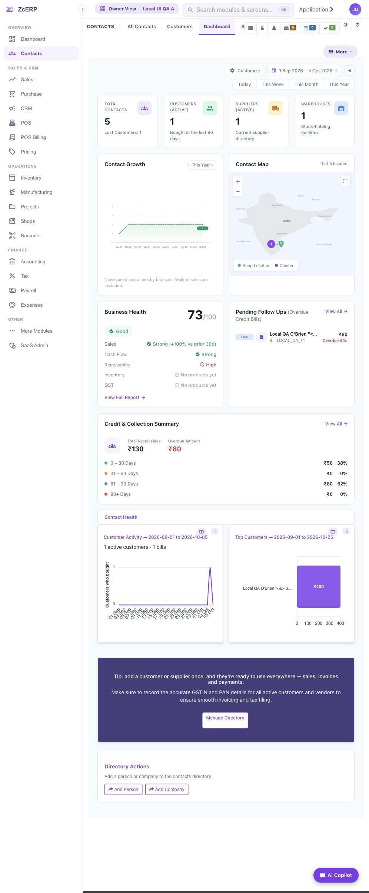
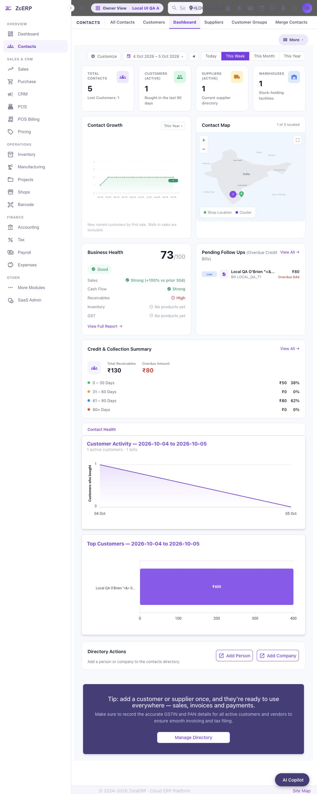

# Contacts Dashboard runtime verification — 5 October 2026

**Historical report:** this 5 October run used a source-built framework jar with a different production hash. The [6 October owner-image follow-up](exact-image.md) records the supplied image, declared overlays, actual narrow/wide viewports and final runtime acceptance; final CI/readiness and cleanup are tracked there.

Follow-up to PR #11. These screenshots are from a running local Moqui application and a fresh PostgreSQL database, not the standalone preview or the mocked action test.

## Changes and scope

- Merged `master` at `ba66e79af0e61969703b9831e8786131afcf9338` into the dashboard branch (merge commit `c8643c8264694fe99cb14d31525e21acb02ce999`).
- Resolved the `ZenithApp.xml` conflict by retaining master's shared theme v253 and navigation assets, and adding the Contacts stylesheet registration to both render modes. The diff against master in this file is just two stylesheet registrations.
- Fixed the custom date form's `action="."` to `action=""`. The old form submitted to the parent Contacts route. Submission now retains the current `ContactsDashboard` leaf and `/apps` or `/qapps` surface.
- Kept the existing shared search, Owner View/shop controls, utilities, sidebar, Contacts navigation and footer. CSS remains scoped under `.zc-dashboard-page`.
- No service, entity schema, API, GST, payment or billing calculation changes.

## Environment and fidelity

Used the workflow in `docs/infra/local-dev-setup.md` and the supplied `local-dev-setup.pdf`: disposable local containers, localhost-only port 8080, a fresh PostgreSQL 15 volume, demo login and synthetic organizations. No production database, account credentials or receipt-signing key was copied.

The documented GHCR base image was inaccessible (HTTP 403 / pull denied), and an owner-provided sanitized image was not available. To perform real runtime testing, Moqui was built from the exact framework source commit documented in `docs/infra/deploy/Dockerfile`, `d12a86e1ac735ae41d93b586bbcb789889997110`. The source build completed successfully. The public Moqui 4.0.0 runtime and the repository's nav, breadcrumb, avatar, lazy-validation, authz-log and INR patches were applied, along with its formatter classes and the changed component tree.

**This is actual Moqui/PostgreSQL verification, but not verification on the exact production image.** The source-built framework jar's MD5 was `efc5a7f8374564e69aa3fa48ecbaf898`; it does not equal the production jar hash recorded in the Dockerfile. Exact-image verification remains a merge gate.

OpenSearch was omitted as permitted by the local setup guide. Search indexing, receipt signing and PDF printing were not tested. Startup logs reported missing FOP tool/servlet classes and unavailable Elastic clients; the dummy signing key also produced a warning. These environment limitations are recorded rather than counted as passing checks. No dashboard Groovy/FreeMarker exception was observed during the requests below, and browser error logs were empty on both surfaces.

## Database ground truth

All data below was generated only for the disposable local test. Test organizations were `LOCAL_QA_A` and `LOCAL_QA_B`.

| Expected value | Organization A | Organization B |
| --- | ---: | ---: |
| Contacts before form tests | 3 | 1 |
| Contacts after form tests | 5 | 1 |
| Active customers | 1 | 1 |
| Suppliers | 1 | 0 |
| Warehouses | 1 | 0 |
| Outstanding credit | 130 | 999999 |
| Overdue credit | 80 | 999999 |
| Customer growth, 2026 cumulative | 2 | 1 |

A contained three synthetic sales across 2025/2026 and two completed credit transactions (80 overdue, 50 current). B contained a distinct 999999 sentinel sale/credit balance. A customer's name included an apostrophe, quotes, `<`, `&` and `>` to exercise chart attribute and visible-text escaping. One customer had two city addresses to check map deduplication.

## Observed runtime results

| Check | Result |
| --- | --- |
| `/apps/zenith/Contacts/ContactsDashboard` | Rendered stat cards, growth/map SVGs, health, follow-ups, aging and optional Apex charts. |
| `/qapps/zenith/Contacts/ContactsDashboard` | Same panels rendered, including both Apex chart SVGs after initialization. |
| Aggregates | Counts and credit/aging values matched the fresh database. |
| Organization switch A → B | Counts changed to 1/1/0/0 and credit to 999999; A's special-character customer was absent. |
| Clear active organization | All four counts and credit balances became zero; growth, map, activity and health showed empty states. |
| Restore A | A's counts and 130/80 balances returned; the foreign credit sentinel was absent. |
| Add Person, `/qapps` | Actual dialog submitted; navigated to EditContact. Database confirmed a new person, customer role and owner A. |
| Add Company, `/apps` | Actual dialog submitted; navigated to EditContact. Database confirmed a new organization, customer role and owner A. |
| This Month preset | Retained `/qapps`; dates changed to 1–5 October, with one active customer and one bill. |
| Growth Last Year | Retained the dashboard and selected 2025; prior-year cumulative count was 1. |
| Reversed custom range, `/qapps` | Dates normalized to 1 September–5 October; corrected form stayed on the exact Dashboard leaf. |
| Custom range, `/apps` | Corrected form stayed on `/apps/zenith/Contacts/ContactsDashboard` and rendered the selected range. |
| Invalid date parameter | Visible validation alert and safe six-month fallback; dashboard still rendered. |
| Map zoom | Zoom-in changed SVG scale to 1.2; zoom-out restored 1.0. |
| SVG corrections | DOM confirmed growth/shop `#10B981`, map `#EFF6FF`, land fill/stroke `#E5E7EB`, region labels `#9CA3AF`. |
| Content overflow, actual viewport 996×806 | No horizontal content overflow: `/apps` width/scrollWidth 742/742; `/qapps` 752/752. |
| Offline action/FreeMarker checks | Passed aggregate parity, org separation, date validation/reversal, growth, empty states, map deduplication and JSON escaping. |
| Repository guards | CSS comments, party picker, cross-module transitions and form DOM collision guards passed. |

## Evidence

The screenshots contain only synthetic local test data and the public demo user. They preserve the actual shared ERP shell.

### Classic `/apps`

### Quasar `/qapps`

## Remaining before merge

1. Repeat runtime verification with the sanitized production image (or the documented pinned image once access is available). This also removes uncertainty about the local FOP/tool classpath.
2. Verify actual narrow and wide viewports. The browser viewport override was requested at 390×844 and 1440×1000, but the measured viewport remained 996×806; mobile/wide checks are therefore **not claimed**.
3. Check preserved shared-shell behavior in that environment: utilities wrap/overlap at this viewport, and the Quasar Owner View label retained A during the organization switch although the active-org badge and dashboard data switched correctly. The PR does not modify those shell controls.
4. Require the GitHub repo-guards check on the final pushed head before merging.

The PR remains Draft until the outstanding runtime/environment gates are completed. No production deployment or merge was performed.

## Cleanup

The local `zeta-contacts-verify` containers, network and fresh PostgreSQL volume were removed with `docker compose ... down -v` after capturing evidence. This removed all fixture rows and both form-created contacts together with the disposable database. No production bill/invoice was edited or renumbered. The original checkout's uncommitted hook edit and untracked PDF were preserved.
