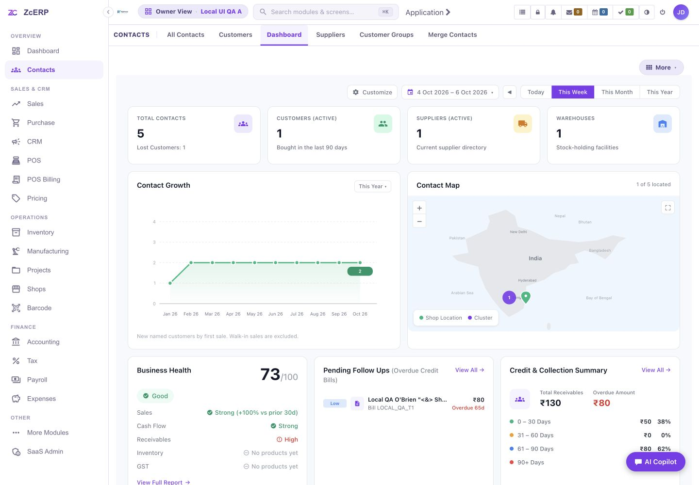
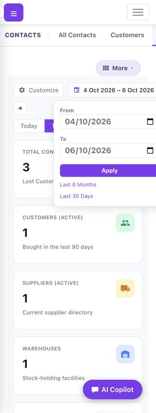
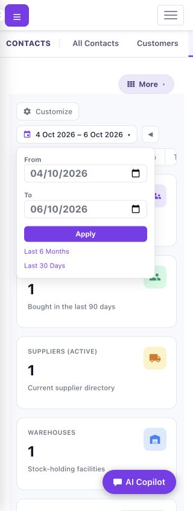
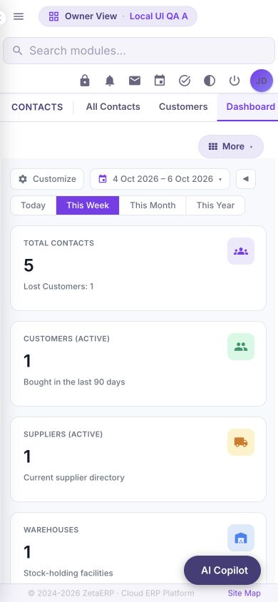

# Contacts Dashboard: owner-image runtime QA — 6 October 2026

PR #11 is closed as superseded by PR #12. This follow-up verifies PR #12 against the owner's sanitized production image and actual narrow/wide browser viewports. **Runtime acceptance passed**, including the Contacts header correction and final five-file parity. The disposable test runtime was removed after evidence collection. Final pushed-head GitHub checks are recorded in PR #12 before readiness. No merge or production deployment was performed.

The starting head was `4d8faf4e0a938eb8c123c125311a8f3d9bf35137` on `fix/contacts-dashboard-runtime`. The latest master `fc38f48` adds staging/infra files only and leaves all five tested application files unchanged; it is incorporated before publication. This report supplements the earlier source-built-runtime report, whose framework hash differed from production.

## Runtime identity and limits

The owner archive SHA-256 is `2da7d916054bf4fccf9c6d32e97b2b2afa0d9ae3531d2a004a4bd87dcf59b18c`; loaded image `zetaerp-moqui:local` is `linux/amd64`, image ID `sha256:5f0314d4183aa6a819c993a0eed8014bd513bd9be1317e366c11a1b1c02b9fe5`. The retained `moqui-framework-4.0.0.jar` MD5 is `df7e767ac4dbefdb4aac35fbccb86192`, matching the documented production hash before and after the application overlays/restarts.

Testing used a fresh local PostgreSQL 15 database and a separate runtime at `127.0.0.1:8081`; the existing PR #14 rig on port 8080 was preserved. The runtime is **the supplied image plus declared local overlays**, including the PR #12 application files and an existing-master qapps route predicate. The image's active qapps guard redirected resolved deep routes because its `extraPathNameList` was empty. The local activation uses the already tracked bare-root predicate from commit `ead5af162670dfafe5a4e84b152aa0e61bd95487`; the imported authentication guard remains intact. This environment correction is disclosed in [provenance](provenance.md), including the activation gap in the deployment Dockerfile.

The bundled load reported 7,950 records and 37 skipped files, so it is a partial demo load. The separate synthetic fixture import succeeded with 52 records across 16 allowed tables. Password fields were untouched. The first anonymous Login probe after the five-file restart timed out at 120 seconds before readiness; the warmed runtime subsequently returned HTTP 200 and passed all 194 checks. OpenSearch was omitted; the final log window had 19 associated retry warnings, five invalidated-login-session warnings and two slow entity-cache read warnings, with zero Dashboard render-exception markers. Browser error collections were empty. This emulated local cold start does not establish production performance. GST/demo integration, search indexing and exports were not covered by this pass.

## Findings and corrections

Each row identifies the reproduced behavior, required result, cause and implemented correction. Paths are repository relative.

| File / affected UI | Current versus required behavior and mismatch | Root cause | Fix and verification |
| --- | --- | --- | --- |
| `component/zenith-erp-app/screen/zenithstatic/css/contacts-dashboard.css` — Dashboard action row | At actual 320 px, the row measured 329 px inside 266 px available content. Controls must wrap within the content width. | Flex item minimum width retained its intrinsic content width. | Added `min-width:0;max-width:100%` to `.zc-control-actions`. Final 320 px content fits; all eight matrix rows have equal client/scroll width. |
| `component/zenith-erp-app/screen/zenithstatic/css/contacts-dashboard.css` — date popup | Popup right edge reached 340 px in a 320 px viewport. Both date fields and Apply must remain reachable. | Right anchoring followed the wrapped controls' position. | At ≤800 px, `.zc-range-pop` uses `left:0;right:auto`. Apps 320 px popup bounds are 27–257 px; qapps bounds are 14–244 px. |
| `component/zenith-erp-app/screen/zenithstatic/css/contacts-dashboard.css` — Tip panel | Classic Apps had a 3 px root overflow. Tip must stay within the Dashboard. | Bootstrap `.row` inherited negative 15 px side gutters inside `#dashExtras`. | Scoped `.zc-dashboard-page #dashExtras>.row` margins to zero. Apps 320 px reports `tipMargin=0px` and Dashboard width 290/290. |
| `component/zenith-erp-contacts/screen/zenith/contacts/Contacts/ContactsDashboard.xml` — map fullscreen | First click entered native fullscreen; a second click could not exit. The same control must restore the page. | Handler always requested fullscreen and never called the document's exit method. | Added native fullscreen-state detection and request/exit toggle, retaining the fallback class toggle. Actual qapps 390 px check entered at 844 px map height and exited back to 280 px. |
| `component/zenith-erp-contacts/screen/zenith/contacts/Contacts/ContactsDashboard.xml` — Customize Close | Close retained `showSettings=1`, leaving settings visible. It must close settings and preserve the selected Dashboard/date route. | The generated link carried the current parameter forward. | Close explicitly sets `showSettings=0`. Actual checks on both shells stay on the Dashboard leaf, preserve dates and hide settings; Save/Reset preferences were also exercised. |
| `component/zenith-erp-app/screen/zenithstatic/css/zenith-theme-v4.css`, `component/zenith-erp-app/screen/zenithstatic/js/qapps-nav.js`, `component/zenith-erp-app/screen/zenith/ZenithApp.xml` — inherited qapps phone header | Search, Owner View/shop and utilities overlapped in the inherited narrow header; reveal-on-scroll could leave a gap above the fixed tabs. Controls and Contacts tabs must remain usable during resize/scroll. | A fixed header/subnav offset did not reserve the wrapped header's actual height or follow Quasar's reveal transform. | Contacts-scoped toolbar grid, `transform:none` and reused PR #14 height measurement through `ResizeObserver`, with updated asset versions. Final 320/390/800/1440 px acceptance passed: tabs meet the measured header bottom, controls fit and scrolling leaves no gap. |

## Functional and persistence evidence

The final native HTTP/PostgreSQL suite passed **194 assertions, zero failed** on the warmed five-file version after the header restart. It exercised authenticated Apps HTML, native qapps and its actual `/apps/zenith/Contacts/ContactsDashboard.qvt` request, with an origin guard preventing redirects to the older port 8080 rig. See [checks](checks-exact.json).

Both shells matched independent database queries through A → B → no organization → A. After browser writes, A had five contacts and B retained one; A's outstanding/overdue credit remained ₹130/₹80. B's distinct ₹999999 sentinel and customer labels were absent from A. No organization produced zero totals and the expected growth, map, health and credit empty states. All five panels and the required growth/shop green, map background, land and label SVG colors rendered.

Actual preset links, custom ranges, reversed dates, invalid-date fallback and previous-year growth retained the Dashboard route and agreed with database activity. The browser created Person `100001` through qapps at 390 px, then edited the last name to `Person Verified`; it created Company `100051` through Apps at 1440 px. Both persisted with owner A and the Customer role. These are disposable fixture writes.

## Measured responsive results

These are actual browser dimensions, not requested overrides. Populated A was used for the matrix; empty states were covered by the native suite. Settled optional Apex chart widths matched their parent widths in every row. Document scroll widths matched the actual viewport width. Dashboard widths below show client/scroll equality from [responsive evidence](responsive-exact.json).

| Shell | Actual viewport | Dashboard client / scroll | Stat columns | Settled chart / parent width |
| --- | --- | --- | ---: | ---: |
| Apps | 320×844 | 290 / 290 | 1 | 232 / 232 |
| Apps | 390×844 | 360 / 360 | 1 | 302 / 302 |
| Apps | 800×1000 | 770 / 770 | 2 | 712 / 712 |
| Apps | 1440×1000 | 1186 / 1186 | 4 | 527 / 527 |
| qapps | 320×844 | 314 / 314 | 1 | 256 / 256 |
| qapps | 390×844 | 384 / 384 | 1 | 326 / 326 |
| qapps | 800×1000 | 780 / 780 | 2 | 722 / 722 |
| qapps | 1440×1000 | 1200 / 1200 | 4 | 1118 / 1118 |

Final shared-header checks are recorded in [header evidence](header-responsive-results.json). At qapps widths 320/390/800/1440 px, header heights were 131/131/141/51 px; Contacts tab tops matched those header bottoms, and reserved page padding was 171/171/181/91 px. Every document stayed within its viewport and every Dashboard client/scroll pair remained equal. Phone scrolling retained `transform:none` and no gap. Returning from `/qapps/zenith` restored the Contacts height variable after it had been cleared outside Contacts.

Header search for `Contacts` showed the correct navigation result; all eight utility links remained present. Phone sidebar opening/dismissal and Person dialog opening/cancellation passed. The Owner View label was present, but this fixture exposes one organization and no shop dropdown, so that dropdown was not exercised. Search-indexing behavior remains outside this pass. Fresh final Apps captures confirmed 1440 px root 1186/1186 and 320 px root 290/290, with 320 px date-popup bounds 27–257 px.

## Screenshots and final gates

The [final parity evidence](final-overlay-parity.json) matches all five application overlays to the running container byte for byte, including the header files and asset versions. The final runtime suite and header acceptance were performed on that version. `git diff --check` passed for the current local diff.

PR #12 may be marked Ready only after required GitHub checks pass on the final pushed head. The owned `zeta-contacts-prod12` containers, network and fresh database volume were removed after evidence collection, deleting all synthetic fixtures and browser-created contacts. The original port 8080 runtime remained running. Final pushed-head GitHub checks are recorded in PR #12 before readiness. No production account password, data, invoice or bill was changed, and no merge or deployment is authorized by this QA outcome.
