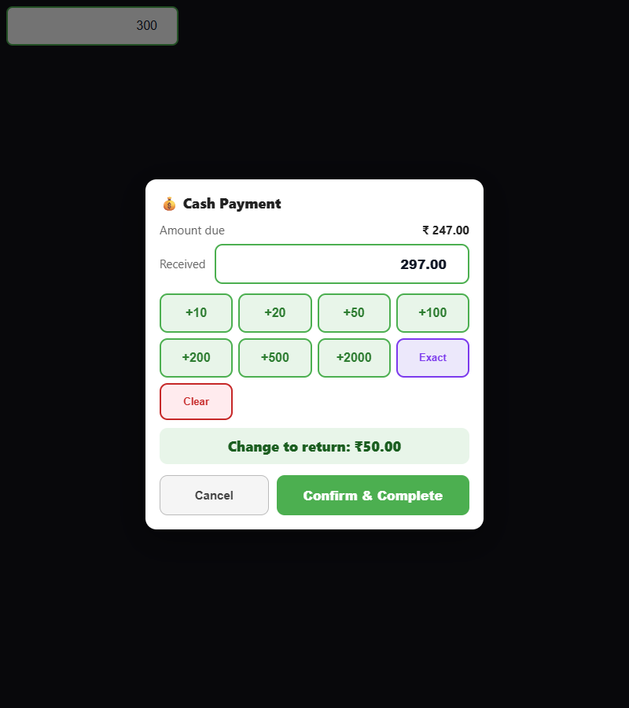

# POS-UI-01 — cash received amount styling

The new Drive report identifies a dark received-amount field inside a light cash payment modal. With `body--dark`, the shared theme sets `color-scheme: dark`; neither cash input provided a light background or native scheme. Chrome reproduced a charcoal `rgb(59,59,59)` background and white text.

The scoped stylesheet now pairs white fill, dark text/caret and a light native color scheme on `#posCashRecv` and `.pos-cash-input`. Keyboard focus has a purple outline. No payment JavaScript, amounts, permissions, server services or data models change. The existing stylesheet URL uses its last-modified version for cache refresh.

## Verification

The isolated browser test loads the actual `posPayCash` function from production JavaScript, the actual summary-panel input template and real styles. It checks default/focus/filled/blur states, insufficient tender, change, Exact, denominations and confirm-event tender values. Confirmation is intercepted on a dummy form; it does not claim to test persisted payment. The POS runtime suite runs the same test in its CI Chromium and continues its existing DB-backed billing/stock/role/tax tests.

Original sources: 6 of 12 browser scenarios fail (the dark-theme scenarios). Candidate: 12/12 pass in Chrome, Edge and WebKit at synthetic dues 247 and 118. These are UI amount scenarios, not tax calculation proofs. Full CI supplies the existing tax-on/off and billing regression gate. No real server, tenant, database or credentials are accessed by the isolated test.

```sh
POS_CASH_OUT=/tmp/cash-ui node docs/qa/pos-cash-ui/verify.cjs
```

Requires the existing Playwright QA dependency and installed Chrome/Edge/WebKit. `POS_CASH_BROWSERS=chrome` plus `POS_QA_CHROME` selects the CI executable.



Manual acceptance: in a test tenant, check both terminal layouts with light/dark themes and Tax On/Off; open Cash, type a larger/insufficient amount, use Exact/Clear/denominations, and verify visible focus and change before submitting only a synthetic sale. Verify cancellation creates no tender. Physical Safari and OS autofill painting remain device checks.

## Other updated report

POS-05-10 again describes zero stock under a conditional negative-stock policy. Existing DB-backed stock enforcement tests cover rejection when enabled and approved opt-outs. Its shop/facility rollout setting remains unverified on the reported deployment. No global stock policy is silently changed and that report remains open.
