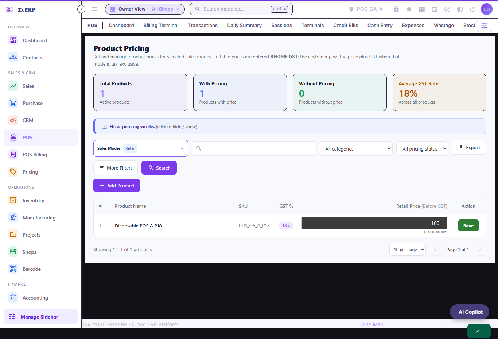
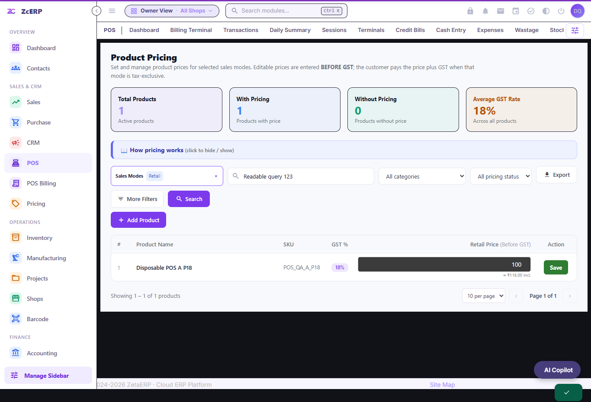
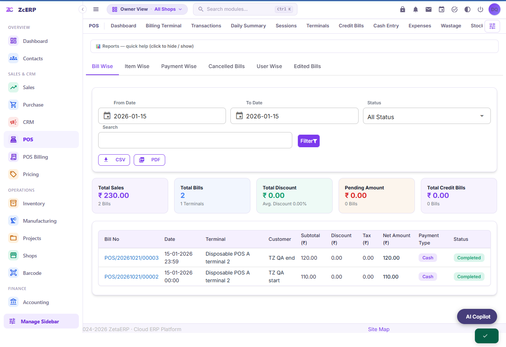

# POS Drive report verification — 20–21 October 2026

This follows the [all-module audit](../all-modules/README.md) in PR #138. The Drive check found 22 files in Vimal Raj's POS Round 2 folder: 15 already marked Completed, six new bug reports, and one older credit-reminder feature request. The Inventory and Sales Round 2 folders were empty. Already completed reports were not reopened.

All writes and screenshots use synthetic POS fixtures on loopback HTTP 18084 and an in-memory H2 database. No customer database, payment provider, physical printer, deployed shop setting, Drive sharing permission, or original report content was changed.

## Findings and report disposition

| Report | Evidence and resulting behavior | Disposition |
| --- | --- | --- |
| POS-05-03, multiple mode selection | Each checkbox formerly submitted the entire page and discarded unsaved row prices. Mode selection now changes visible columns in place, preserves drafts, and batches/serializes own-user preference writes. Filter and export URLs retain the selection. Failed preference requests offer Retry without discarding edits. | Implemented and verified in both layouts. |
| POS-05-04, empty selection | The last checkbox silently stayed selected. A live message now explains that at least one available mode must remain selected. Wholesale alone is valid; Retail is not mandatory. Mouse and keyboard cases pass. Server preference writes reject empty/foreign/unknown modes without changing the saved preference. | Implemented and verified in both layouts. |
| POS-05-13, invisible search text | Light mode passed before the fix; the supported dark-theme class made typed text white on the white filter field. Scoped text/fill/caret rules preserve readable contrast in both themes. Rules live in the shared stylesheet, not a style tag inside a Vue subscreen. | Implemented and verified in both layouts. |
| POS-04-07, rate override | An authorized owner's actual input/Enter save already worked on the reviewed source. AJAX edits omitted override history. AJAX and legacy forms now call one scope-checked, transaction-locked service that preserves the existing POS write grants, including the cashier role. Successful changes record actor, session and original/new price; same-price retries add no duplicate history. Tax is recalculated from the product and mode, including tax off, tax on after off, discounts and inclusive tax. | Owner, Store Manager and configured cashier write paths are verified. Read-only and foreign access is rejected. This does not identify the older deployed owner's failure without that deployment/role evidence. |
| POS-05-10, zero stock | The fixture with shop stock enforcement enabled rejects a tracked item with exactly zero stock, names the product/facility and leaves the cart empty. Existing opt-out and facility negative-stock policies are deliberate rollout settings. | Open: confirm the reported shop's enforcement flag and facility policy. No global default changed. |
| POS-04-09, zero/no price | Current business tests deliberately permit an explicit free product and a zero-total cash sale. Blocking every zero price would change that existing policy. | Open: user decision requested between manager approval/reason and blocking every zero-price item. Existing policy preserved while awaiting the answer. |
| POS-10-05, credit reminders | Existing code already records settlement timestamps and configurable customer terms, including two- and thirty-day terms. Consent/idempotent reminder preparation exists; delivery is disabled without a configured provider. | Open: delivery provider/configuration remains outstanding. See [credit evidence](../pos-runtime/credit-terms-evidence/README.md). |

Completed in Drive means implemented and verified for the PR; it does not mean merged or deployed. Reports requiring a policy, deployed configuration or delivery provider remain open.

Only POS-05-03, POS-05-04 and POS-05-13 are marked Completed. POS-04-07 remains open for verification on the reported deployment: its missing AJAX audit is fixed, but the original owner's failed save was not reproduced on the reviewed code. The three other open reports above are not marked resolved by inference.

## Hypotheses and disproof checks

| Before-patch hypothesis | Evidence that would disprove it |
| --- | --- |
| Mode-change form submission causes the reload and discarded draft. Updating columns in place should preserve the typed value. | A real browser navigation still occurs, the draft changes, or a hidden mode is written by Save. |
| The dark-theme text rule makes a white search field unreadable. A scoped field rule should retain readable contrast. | Computed text/background contrast stays below 4.5:1 after typing and blur in either layout. |
| AJAX rate edits omit the override entity write. One shared service should record only actual changes. | Independent SQL finds no actor/original/new-price row, duplicates on same-price retry, incorrect GST, or a foreign/read-only write. Configured cashier access must still work. |
| Totals read their lines before locking the header and can overwrite a concurrent add with an old snapshot. Parent-first locking should serialize these requests. | The controlled schedule returns success but stored header totals differ from the committed item totals. |
| Local date labels and JVM-based midnight bounds disagree. User-timezone boundaries should include the exact start/end of the selected day. | UI, CSV, PDF, Sales counts or forecast buckets exclude local-day records or include adjacent-day records. |

## Regression evidence

| Final local suite | Passing assertions | Failures |
| --- | ---: | ---: |
| Pricing, rate edits, role changes and free-item preservation | 61 | 0 |
| Local-day UI/CSV/PDF and owner chart | 12 | 0 |
| Controlled concurrent cart mutations | 16 | 0 |
| Full POS regression | 1,122 | 0 |
| Fresh Sales regression | 1,225 | 0 |
| **This phase** | **2,436** | **0** |

The Sales rerun replaces the same 1,225-assertion suite in the first phase; it is not counted twice. Combining the documented phases gives 8,218 non-duplicated assertion results, with the source and incremental-verification qualifications below. This is not a claim that every first-phase suite was rerun on the last commit. The follow-up has 22 confirmed original failing assertions across six grouped findings. Two additional owner-chart assertions caught the uncommitted candidate's millisecond regression and are recorded separately, not counted as new original bugs.

The pre-patch pricing reproduction has eight valid failures across the two layouts: dark-mode text contrast, document reload, lost price draft, and missing last-mode explanation. An additional independently checked baseline failure covers missing override history. The original owner-edit success is retained. An exploratory cashier-denial assertion is excluded: the code explicitly grants that role full POS write access and supports cashier-entered prices. It is existing behavior, not an unauthorized edit.

The targeted regression exercises real browser interactions and HTTP transitions, then independently reads stored rows through the SELECT-only probe. Cases include three-mode column counts, batched preference requests, keyboard selection, preference reload, selected-column-only saves, simulated HTTP 503/non-JSON failure and retry, CSRF, foreign scope, invalid numeric rates, immutable completed bills, exact 18% GST, tax-off cleanup, quantity/discount preservation and inclusive-tax arithmetic. Its role matrix preserves cashier and mixed-role POS writers, verifies Store Manager input/confirmation, and rejects the same signed-in session after its POS write grant is removed. The JSON evidence records actual final counts.

The full run also exposed a separate cart concurrency bug: a terminal refresh could read an empty item snapshot, wait for another request to add a valid ₹100 + ₹18 GST line, then overwrite the bill header with zero. A controlled scheduling test reproduces this for totals and repricing before the fix. Both HTTP operations succeeded, so simply checking response status would miss the corruption. Totals calculation now locks the parent bill before reading lines; repricing, mode changes and removal use the same parent-first order as add/payment/rate override. All **16 controlled concurrency assertions** pass after the fix, including item preservation and mode/removal paths. Only the two reproduced zero-total failures are counted as additional baseline regressions.

The JSON evidence and source fingerprints accompany this document. Intermediate harness mistakes are excluded: a checkbox test originally used Playwright's `uncheck()` despite intentionally restoring the final checkbox, and an inclusive-price test initially chose an undiscounted MRP mode while expecting a discount. Neither is counted as a product bug. The candidate's temporary inline-style Vue freeze was caught and removed before commit; both layouts subsequently pass.

The after-midnight run exposed a second product defect. POS report bounds used JVM midnight while their date labels used the user's time zone. A bill made just after midnight in India disappeared from today's report. Synthetic boundary bills demonstrate nine failures before the fix: screens, CSV, item totals, audit dates and PDF omit/include the wrong records. Report bounds now reuse the timezone-aware parser already used by Payment Wise and Daily Summary. The tests include the first and final millisecond of a local day and exclude adjacent days. Sales dashboard ranges and forecast day buckets now use the same configured user calendar; the history fixture stores local-noon instants in that calendar. Date-only credit due dates are unchanged.

Native runtime corrections are excluded from the bug count. A stale helper mounted at a second POS location lacked the current idle-clock transition; the canonical helper replaces it. Sales keyboard tests wait for a stable dialog and actual Quantity → Price focus, retaining their Enter/double-submit checks and failure screenshots.

All owned native memory JVMs were stopped after verification. HTTP/H2 listeners 18083/19095 and 18084/19096 were checked closed. The four repository guards, changed XML/JavaScript syntax, and whitespace checks pass. The first-phase npm test/build attempts remain ENOENT because there is no root package.json.

The earlier all-module report's 1,122 POS assertions were historical same-source evidence at its first-phase commit. New POS source changes invalidate that reuse for the final candidate: use this phase's fresh full POS run and fingerprints instead. The first phase's 7,007 assertions remain evidence for its documented commit; the 32 suites were not all rerun for these scoped POS changes.

The new full local POS run passes 1,122 assertions (56 pages, 100 layout observations). A subsequent boundary review caught a millisecond-reset defect in the uncommitted owner-chart candidate; the final date suite verifies that last correction independently. The evidence preserves the owner source hash used during the full local run, rather than calling that run byte-identical to the later chart correction. Final-head Linux/PostgreSQL POS verification is assessed separately in GitHub Actions.

Synthetic screenshot evidence:







## Reproduction

Use a fresh, private native Moqui runtime with the existing guarded [POS fixtures and helper](../pos-runtime/README.md), scheduled jobs disabled, no external mail/payment configuration, HTTP bound to 127.0.0.1:18084 and H2 TCP to 127.0.0.1:19096. The JDBC database must be memory-only `pos-qa`. Do not install QA helpers on production.

The targeted suite additionally needs a synthetic tracked product `POS_QA_DRIVE_ZERO_STOCK`, owned by `POS_QA_A`, named `Disposable zero stock probe`, type `PtAsset`, amount UOM `OTH_ea`, MRP 10, slab `GST_0`, `inventoryTracked=Y`, with no assets. Add it only to the disposable fixture. Fresh fixtures are required for each run.

Set `NODE_PATH` to Playwright dependencies, `POS_QA_NATIVE_ROOT` to that native runtime, `POS_QA_JAVA` to JDK 21's Java executable, and `POS_DRIVE_OUT` to a private evidence folder. The Windows native runner uses installed Chrome. Run:

```text
node docs/qa/pos-drive-reports/verify.cjs
```

For the full POS regression use another fresh memory database with the canonical fixture (without the extra zero-stock product), set `POS_QA_BASE`, `POS_QA_CHROME` and `POS_QA_OUT`, then run:

```text
node docs/qa/pos-runtime/verify-runtime.cjs
```

The existing pricing-history test now verifies that unselected columns are hidden and their price inputs disabled, rather than requiring those cached columns to be absent from the DOM. It still verifies persistence, history navigation, one save request, foreign scope and actual stored prices.

To reproduce the concurrency scheduling test, compile `PosTotalsBarrier.java` into the disposable runtime's `runtime/classes`, mount `totals-race-screen.xml` as `Pos/PosQaTotalsRace.xml`, and place `totals-race.eecas.xml` only in that disposable component's `entity` directory. The barrier pauses immediately before the real header update, using Moqui's [before-operation EECA hook](https://raw.githubusercontent.com/moqui/moqui-framework/master/framework/xsd/entity-eca-3.xsd). It changes scheduling, not totals or SQL data. Access is restricted to the synthetic `pos.qa` account and its own open fixture bill, with `pos.qa.disposable=true`. The Java state is JVM-local and thread-bound; no non-serializable latches are stored in browser sessions. Run `node docs/qa/pos-drive-reports/totals-race.cjs` with the native variables above. Remove the scheduling helper/rule before ordinary full regression runs, and stop the memory JVM afterward.

## Modified production files

- `zenith-erp-pos/.../ProductPricing.xml`: own-user selection preference, available-mode data and initially hidden/disabled columns.
- `zenith-erp-app/.../pos-product-pricing.js`: in-place selection, request batching, failure/retry, URL preservation and selected-price-only saves.
- `zenith-erp-app/.../pos-reference.css` and `ZenithApp.xml`: scoped contrast/visibility rules and versioned asset references in both layouts.
- `zenith-erp-pos/.../PosPriceServices.xml`: shared authorization, state/amount validation, row locking, audit and canonical tax calculation.
- `zenith-erp-pos/.../PosServices.xml`: parent-row locking before total snapshots and a consistent lock order for related cart mutations.
- `zenith-erp-pos/.../Terminal.xml` and `zenith-erp-app/.../pos-terminal.js`: both write paths use the service and the existing POS write permission.
- POS report/audit/PDF date filters, expense/KOT/owner default date calculations, and the bill-register calendar use the configured time zone.
- Sales dashboard ranges and forecast day grouping use local calendar boundaries instead of JVM/UTC dates.

Physical receipt hardware, the reported deployed owner's exact role, the zero-price business decision, deployed stock-policy values, production capacity and live reminder delivery are outside this local proof.
