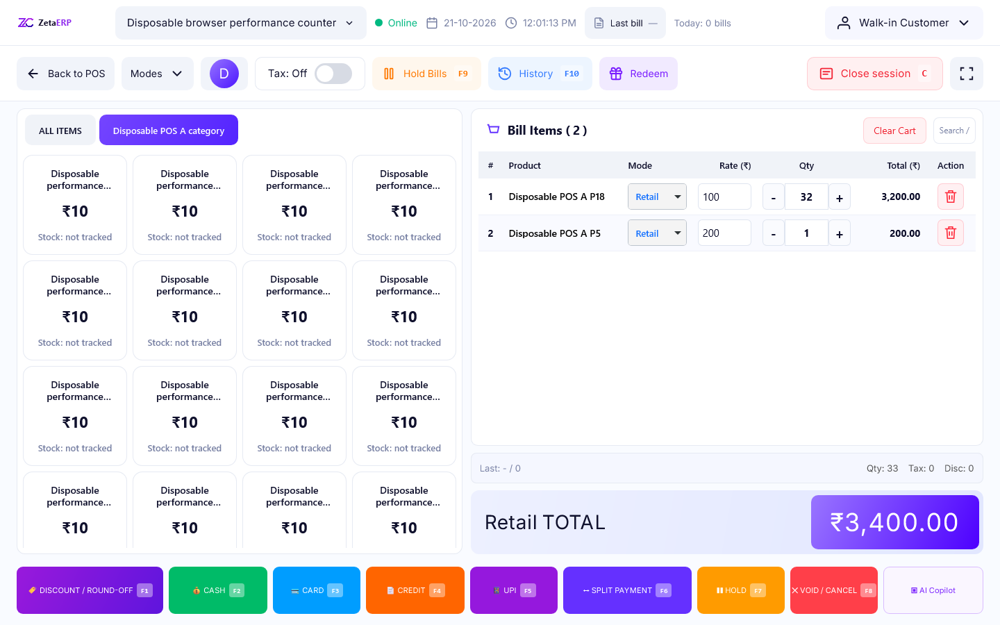

# POS browser performance verification

This change addresses the POS billing bottleneck reported on 21 October 2026.
It preserves the ZetaERP palette and layout. It does not claim to accelerate every
ERP module or replace the separate business-rule fixes in PR #138.

## Mechanism

- Product additions update the existing optimistic model immediately, coalesce
  visual updates into the next animation frame, and retain the existing server
  operation queue. Quantity buttons step from the current model, including additions
  that have not painted yet. Payment/hold controls flush a pending frame before
  reading the form. Detached terminal forms cannot paint into a new screen.
- Rows retain their identity. Only changed cells are replaced, so quantity changes
  and row renumbering retain unrelated price drafts and input focus.
- Category, search and Load more requests use the POST/CSRF-protected
  `Terminal/productGrid` response. The initial screen and endpoint share the
  existing catalog query and live price-list lookup. Each page contains at most
  60 cards. Terminal modes, product ownership, category ownership, facility stock
  and fixed-mode missing-price restrictions remain enforced on the server.
- Product presses use native active-state color feedback, without the old 250 ms
  scaling/shadow timer. No browser-specific scheduling API is required.

## Evidence and limits

`verification.json` records the measured application-file hashes, browser versions,
observed local timings and completed test results. The first full baseline used
master `ac5c8f5c`; the additional frontend comparison intercepted **the browser
context's** terminal asset with that exact baseline script while keeping the
candidate backend and synthetic database the same. Service workers were blocked
for that controlled comparison and the harness asserts that interception ran.

The benchmark is a burst of 20 additions plus one immediate quantity increment,
measured through two animation frames. This includes visual work; the much smaller
JavaScript enqueue-call duration alone is **not** a paint-time measurement.
Numbers are observations on one workstation, not production latency guarantees.
Chrome and Microsoft Edge run their installed applications. WebKit is an engine
compatibility check; an Apple device running Safari remains a separate acceptance
check. External printers, payment providers and customer network conditions are
outside this synthetic test.

The full POS acceptance runner imports `verify-catalog-performance.cjs`. It checks
both JSON routes, token/GET/tenant/mode boundaries, persisted prices, read-only DB
snapshots, rapid-click persistence, retained drafts and an immediate cash-panel
click. The existing suite separately covers tax on/off, modes, payments, stock,
hold/recall, receipts and both app shells. Catalog race/failure tests intercept the
new JSON transport and retain their ordering and recovery assertions.

## Reproduce locally

Use only the isolated loopback runtime described in
[`../pos-runtime/README.md`](../pos-runtime/README.md). Never install the QA helper
on a live ERP. Set `NODE_PATH` to the installed Playwright package directory.

1. Run the full POS acceptance runner with `POS_QA_NATIVE_ROOT`, `POS_QA_JAVA` and
   `POS_QA_OUT` pointing to the disposable H2 runtime and evidence directory.
2. Run `node docs/qa/pos-runtime/verify-catalog-navigation.cjs` with the same output
   directory. It verifies delayed search/category responses and HTTP/network failure.
3. After the full suite, run `node docs/qa/pos-performance/verify.cjs` with
   `POS_PERF_OUT` set to a new evidence directory and `POS_PERF_SEED=true`. This
   creates 75 synthetic products through the existing guarded test helper and
   checks both catalog pages in Chrome, Edge and WebKit. On a fresh, uninitialized
   runtime also set `POS_PERF_INITIALIZE=true`; never initialize an existing fixture.
4. For the controlled frontend baseline, set `POS_PERF_SOURCE_SCRIPT` to the
   original terminal JavaScript exported from the recorded master commit. Restore
   the variable to empty for the candidate run. Baseline failures are expected.
5. Stop only the owned QA JVM. Verify its HTTP/H2 listeners are closed. The database
   is in memory; ending that JVM discards all synthetic users, carts and products.

## Manual acceptance

1. Enter an active session through POS Billing from each app shell. Check the
   header, grid, cart and payment controls at desktop and mobile widths.
2. Repeatedly tap one product, then alternate products. Confirm immediate feedback,
   exact quantities after the requests settle, and an unchanged total after reload.
3. Type an unsubmitted price into a different row. Add items, change another row's
   quantity and remove an earlier row. Confirm the draft and focus remain intact.
4. Add an item and immediately open Cash; confirm the new total is shown. Repeat
   quantity/add ordering, split payment, hold/recall and keyboard shortcuts.
5. Test Retail and a fixed-price mode with tax off and on. An unavailable fixed
   price must remain blocked; do not substitute a free or retail price.
6. Search by name, SKU and id. Check an empty result, category changes, All Items,
   Load more and repeated rapid navigation with network throttling.
7. Disconnect or fail a catalog request. Confirm the previous products remain
   usable, the error is visible, and the current cart is unchanged.
8. Repeat on an actual Safari device, including touch, rotation, keyboard input,
   browser print and receipt printer integration.

Deploy the reviewed complete component tree together and restart through the
maintainer's normal process. The terminal's versioned asset URLs are bumped.
There is no schema migration, historical data rewrite or deployment in this task.

## Observed local results

| Browser | Original burst to frame | Candidate burst to frame |
| --- | ---: | ---: |
| Chrome | 1219.9 ms | 85.0 ms |
| Edge | 1327.5 ms | 95.6 ms |
| WebKit | 335.0 ms | 63.0 ms |

All 37 browser checks, 35 focused database/workflow checks and five navigation checks passed. The sampled category payload fell from 55,005 to 1,057 bytes. Complete-suite staging results belong to the exact CI head linked in the PR.

