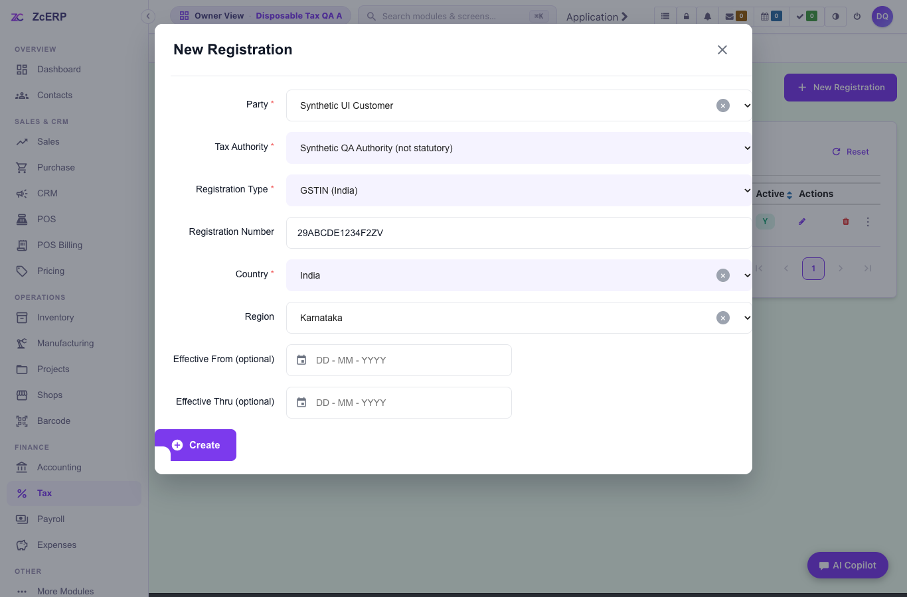
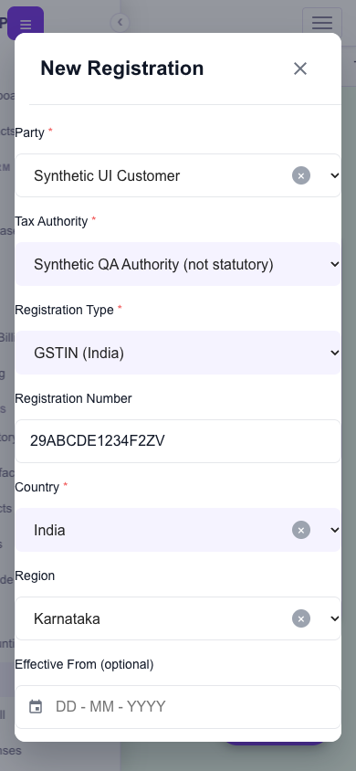

# Local verification evidence

- Date: 7 October 2026. Component overlay matches the candidate application changes; latest master was merged without conflicts. Subsequent changes exclude unverified legacy TDS deduction/deposit edits.
- Clean runtime archive SHA256: `0305b2d2f7124781c41de04eb8aa8a7847ee5116ee01f09dc52d7f12dc513b93`.
- Running framework jar SHA256: `47c2b9cd86b005437abb75dbfd2d5027c00687ead4c5f7b0c9577b340f9e2e3d`.
- **65/65 service cases passed**, including actual Sales create and Purchase create/addItem.
- **29/29 browser cases passed** on both `/apps` and `/qapps`. Fourteen screen checks cover five widths: 1920, 1366, 800, 390, 320. Native registration/exemption create/edit, country/region refresh, no-match/status filtering, CSRF rejection, foreign edit denial, GSTR generation/FY/detail/download and GSTR2/3B redirect results pass. No uncaught browser JavaScript errors.
- **Independent SQL assertions passed** (`assert.sql`, psql ON_ERROR_STOP): foreign rows unchanged; invalid period has no filing; correct B2B/B2CL stored tax; no mock statutory records; tax-inclusive invoice convention; both native create/edit records persisted; CSRF wrote no row; actual Sales and Purchase headers equal 100+18=118.
- **Existing POS database goldens passed:** Retail 100+18=118; Wholesale 540+64.80=604.80, payable605 and roundoff.20; Employee80+4=84; split cash60+card58=118; line prices, CGST/SGST and completion status checked.
- All four repository guards pass. Changed XML and workflow YAML parse; both JavaScript helpers and browser test parse; whitespace check passes with CRLF handling.
- Disposable Docker project torn down; **zero containers and zero volumes remain**. No production writes or login changes. Ephemeral session-bearing probe files excluded from deliverables.

[Service case summary](evidence/services-summary.json) · [Browser case summary](evidence/ui-summary.json) · [Teardown proof](evidence/teardown.json)

## Synthetic previews

## Limits

This is a clean staging runtime with a candidate overlay, not a byte-identical production image. It is not a GSTN schema certification or a live-tenant no-op approval. See [remaining gates](REPORT.md). Exact-SHA GitHub workflow results are linked in the PR; local results do not imply CI passed.
