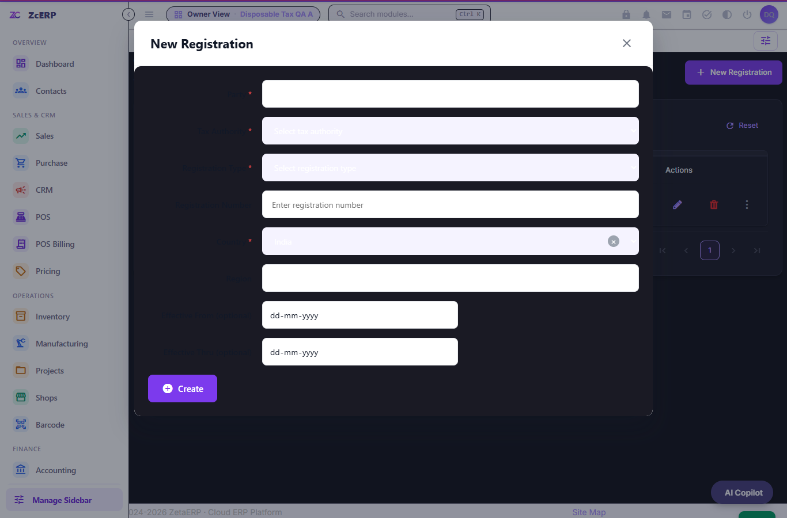
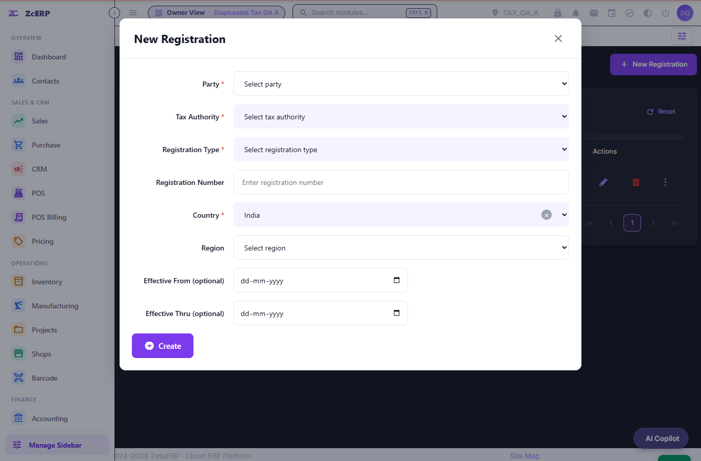

# POS-07-07 — Tax Registration dropdown visibility

The updated Drive report concerns the Tax → Tax Registrations → New Registration form. It does not report a Retail/Wholesale tax calculation defect.

## Reproduction and cause

Open New Registration with the app's `body--dark` theme active. The controls keep their inline white/lavender backgrounds but inherit a dark `color-scheme` and pale foreground. Measured contrast was 1.27:1 in `/apps` and 1.00:1 in `/qapps`, below 4.5:1. The form background also followed the dark card variable while its labels kept dark text. The baseline test fails four of six scenarios; light-theme cases already pass.

The shared Tax native form now uses its existing light palette explicitly, including a matching native color scheme. Selects, option groups, selected options and disabled text have paired readable foreground/background colors. Purple focus outlines remain. CSS is scoped to `.zc-tax-page .zc-tax-form`; the Tax CSS URL advances to v4. There are no entity, service, registration-write or permission changes.

## Verification

- Chrome, Edge and WebKit: 21/21 runner cases, including six targeted scenarios per engine across `/apps` and `/qapps`, default/hover/focus/disabled/selected text, keyboard selection and zero registration writes. No unhandled script exception was observed.
- Modal bounds and Create-button reachability: 1366, 800, 390 and 320 px.
- Existing Tax acceptance: 70/70 service cases and 37/37 browser cases, including create/edit persistence, country → region, CSRF, foreign-record denial and read-only roles.
- The synthetic cross-module supplier fixture now has the Supplier role that current Purchase validation requires; no application rule was weakened.
- Four repository guards pass; changed XML/JavaScript parse and `git diff --check` pass.
- Requested `npm run test` and `npm run build` both fail ENOENT (-4058): this Moqui repository has no root package.json. They are not counted as passes.

WebKit also emits a `ResizeObserver loop completed with undelivered notifications.` browser delivery notification during viewport resizing. The same notification reproduces with the original CSS. It remains recorded separately in the cross-browser diagnostics; this change does not claim to repair that existing framework notification.

See [recorded results](dropdown-verification.json). Tests use a disposable loopback H2 memory database and clearly synthetic Tax accounts/records. Browser-only dropdown checks submit no registrations. No production tenant was accessed or changed.

Native popup dimensions and painting are controlled partly by the browser/OS. The tests verify the supplied styles and keyboard behavior, not every physical popup or an actual Apple Safari installation. Check those on the target device before deployment.

## Manual acceptance

1. Sign in to a test tenant on each app shell. Open Tax Registrations in light and dark themes.
2. Open New Registration. Open Party, Tax Authority, Registration Type, Country and Region; inspect placeholder, selected label and menu text.
3. Use keyboard arrows to select a type; verify the visible label remains after dismissal. Tab/Shift+Tab through the modal; Escape must close and restore opener focus.
4. Change Country and confirm Region refreshes and stays readable. In a narrow viewport, reach Create without horizontal page overflow.
5. Create a synthetic registration, reload and edit it. Check Tax Exemptions and other modules retain their existing navigation and styles. Delete only the synthetic test data afterwards.
