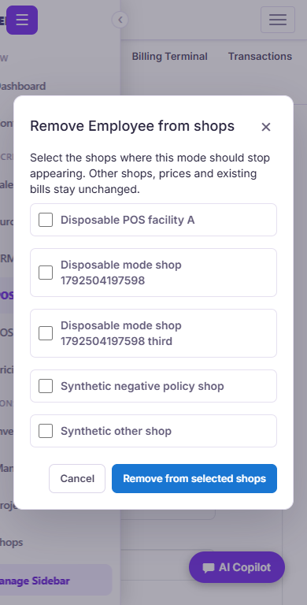
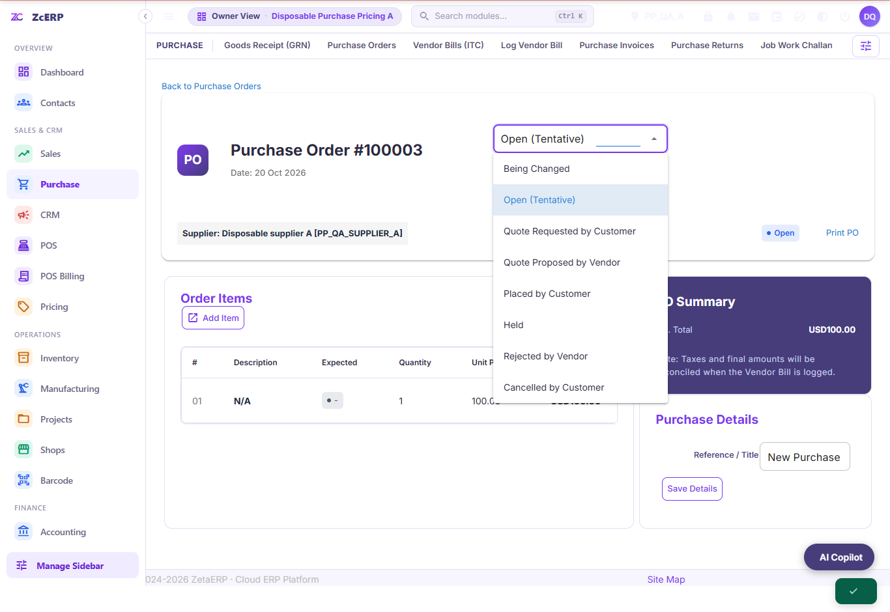

# Zenith workflow audit — 20 October 2026

## Confirmed problems and changes

| Area | Reproduction before the change | Result |
| --- | --- | --- |
| POS category/search navigation | A delayed response replaced a newer selection. Network failures left product controls disabled; HTTP errors could replace the catalog. All four focused regressions failed on master. | Cancel obsolete requests, accept only the latest response, reject HTTP errors, and restore the previous usable catalog and selected category after a failure. Cached All Items remains immediate. |
| Sales Mode removal | Shared modes had disabled Delete buttons. A shop could not remove a shared mode without changing its global definition. | Delete opens a physical-shop picker. Persist an exclusion only for selected, authorized shops. Restore is available per shop. Global mode definitions, prices and issued bills remain intact. |
| Purchase Order status | Both interfaces offered every OrderHeader status. Open orders therefore offered Completed even though the configured workflow rejects that jump. The focused test reproduced this on both interfaces. | Show the current status and permitted next statuses from the same Default workflow and user-permission rule used by the server. The real buttons verify Open → Placed → Approved → Completed. |

The Purchase status change preserves the configured workflow. It does not silently complete an unapproved order or change receipt/stock/accounting rules.

## Scope and authorization

Mode removal validates the complete selected shop list against the caller's active organization and retail-facility type before writing. It requires POS module write access and an administrator role. Default Retail remains available. Open and held carts using a mode prevent its removal in their shops. Terminal choices and server-side add/reprice/line-mode paths share availability checks; a manual price cannot bypass the removal. New terminals inherit the shop exclusion. Other organizations' shop IDs are rejected, and POST/CSRF protections remain enabled.

Purchase retains its existing stored-parent, organization, write-access and status-transition checks. Only the status menu changes. No issued invoice or bill is edited or renumbered by these fixes.

## Verification

All database writes used loopback, disposable in-memory H2 runtimes with synthetic fixtures. Independent Java probes executed SELECT-only SQL. Counts and source fingerprints are recorded in [verification.json](verification.json).

Final results: **1,122 POS + 34 shop-removal + 4 catalog + 368 Purchase + 10 status checks passed**, both GRN button submissions persisted exactly one row, and the separate stock-transfer smoke passed. Both in-memory runtimes were discarded and their database ports were confirmed closed. All nine changed production files matched their tested runtime source by SHA256.

- POS full suite: billing with tax on/off, payment methods, GST arithmetic, discounts, edits, holds/recall, idle sessions, customer selection, tenant/role boundaries, 56 pages and 100 responsive layouts.
- Shop removal: real submissions in `/apps` and `/qapps`, multiple selected shops among three owned shops, open/held-cart rejection, new-terminal inheritance, forged/manual-price rejection, restore isolation, cashier/CSRF/default-mode protection, and 1366/390-pixel dialogs.
- Catalog: deliberately reordered searches/categories, failed transport and HTTP 503, with the cart preserved. Added this test to the POS staging profile.
- Inventory stock-transfer smoke: physical facility picker, invalid/foreign destination rejection, ship/receive balance changes and duplicate-receipt safety.
- Purchase full suite: orders, GRNs, returns, payment promises, scope/role/CSRF boundaries, CSV and responsive layouts, with exact fixture cleanup independently checked.
- Purchase focused browser tests: actual Update Status controls through completion, rejected Open → Completed, and actual GRN creation with the screenshot's date and ₹50 freight in both interfaces.
- All four repository guards, changed XML parsing, JavaScript syntax checks and `git diff --check`.

## Screenshots

These show synthetic test records only.

## Limits and follow-up

The screenshot's generic deployed-site error was not reproduced locally. Valid completion succeeds after approval; direct completion from Open is rejected without database writes. The invalid menu choices are a confirmed defect and are fixed here. If an already-approved order still produces a generic error on the deployed site, its server exception and deployed commit are needed to identify that separate failure. No production financial test write or deployment was performed.

`npm run test` and `npm run build` return ENOENT because this Moqui XML/Groovy repository has no package.json. The native runtime and repository guards above are the actual verification; no npm success is claimed. Local H2 results do not replace Linux/PostgreSQL staging acceptance, and this bounded audit does not certify every ERP module or device as bug-free.

The requested eight bug-bounty repositories were cloned outside the ERP. Strix 1.7.0's CLI was installed and its version/help verified. BBOT and ReconFTW require a supported Linux environment, which is unavailable on this Windows host. Strix scans still require a working Docker engine and provider configuration. No broad or production security scan was started.

## Reproduction commands

Use the setup described in the existing [POS](../pos-runtime/README.md) and [Purchase](../purchase-remaining/README.md) QA guides. Helpers are disposable-only and must never be deployed.

After the POS full suite, run `verify-catalog-navigation.cjs` and `verify-mode-shop-removal.cjs` with `POS_QA_NATIVE_ROOT`, `POS_QA_JAVA`, `POS_QA_OUT` and loopback `POS_QA_BASE`. The shop-removal runner uses the native H2 probe; the catalog test also runs in the PostgreSQL staging profile. Run `stock-transfers/verify-native.cjs` on a fresh disposable runtime because it initializes its own fixture.

On the Purchase remaining profile, run `verify.cjs`, then `verify-order-status.cjs` and `verify-grn-dialog.cjs` using `PURCHASE_QA_RUNTIME`, `PURCHASE_QA_JAVA` and `PURCHASE_QA_OUT`. The focused runners initialize the disposable fixture if the full suite has cleaned it up. Discard the complete in-memory runtimes after all checks.
